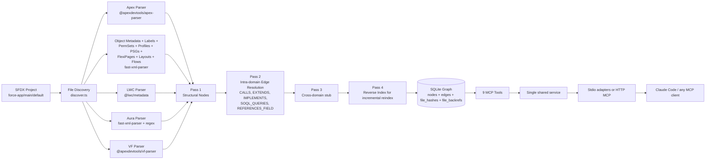

# Spindle

**A local-first MCP server that indexes SFDX projects into a queryable metadata graph.**

Spindle replaces grep-and-read loops with single-call graph queries for Salesforce-shaped questions: "who calls this method", "what references this field", "who can access this class". The graph treats every metadata artifact as a first-class node (Apex classes, LWC bundles, Aura components, SObjects, fields, validation rules, Visualforce pages) and every reference between them as a typed edge.

| | |
|---|---|
| **Status** | v1.1.2 package; unreleased remediation adds one shared service, 9 MCP tools and Workbench UI (`sfdx-graph-mcp ui`) |
| **Headline** | Returns answers in ~24% of the tokens a grep+read flow would use on a 100-class corpus, dropping to ~2.4% on a 1000-class corpus — token efficiency scales with project size — and 180x+ faster |
| **Distribution** | Single Bun-compiled binary per platform via GitHub Releases. Cross-compile to darwin-arm64, darwin-x64, linux-x64, linux-arm64, windows-x64 validated. Matrix build wired into `.github/workflows/release.yml`. |
| **License** | MIT |

See `sfdx-graph-mcp-design.md` for the full design document and `CHANGELOG.md` for what's actually shipped.

---

## Why

Claude Code (and similar coding agents) currently navigate SFDX projects the same way they navigate any other codebase: grep, glob, and read files one at a time. For SFDX this is uniquely wasteful because:

- A single field can be referenced in Apex, LWC, Aura, Flow XML, validation rules, layouts, permission sets, profiles, email templates, and formula fields on related objects. No grep query covers all of these correctly.
- "Who can run this Apex method" requires joining classes, permission sets, profiles, and permission set groups. Grep returns noise; the answer is a graph traversal.
- Metadata XML is verbose — reading a single object folder can mean dozens of small files of structural ceremony around one fact.

Spindle indexes the project once into SQLite (~600ms for a 100-class project), then answers structural questions in sub-millisecond graph queries.

---

## Quick start

### One-line install (once a release is tagged)

POSIX (macOS / Linux):

```bash
curl -fsSL https://raw.githubusercontent.com/Kelley-Austin/Spindle/main/install.sh | sh
```

Windows (PowerShell):

```powershell
iwr -useb https://raw.githubusercontent.com/Kelley-Austin/Spindle/main/install.ps1 | iex
```

The installer detects your platform, downloads the matching binary from the latest GitHub Release, verifies its SHA256 against the release's `SHA256SUMS` file, and installs to `/usr/local/bin` (or `~/.local/bin` if the former isn't writable) on POSIX, or `$LOCALAPPDATA\Programs\spindle` on Windows.

Env vars to control behavior:
- `SPINDLE_VERSION=v0.5.0` pin to a tag (default: latest)
- `SPINDLE_PREFIX=/opt/spindle/bin` override the install location
- `SPINDLE_REPO=other/fork` override the source repo

### Run from source

```bash
git clone https://github.com/Kelley-Austin/Spindle.git
cd Spindle
bun install
cd web && bun install --frozen-lockfile && cd ..
bun test --timeout 30000
bun run typecheck         # tsc --noEmit
bun run build             # -> dist/sfdx-graph-mcp (single-binary, ~62MB)
```

### Index an SFDX project

```bash
sfdx-graph-mcp index /path/to/your/sfdx-project --full
```

This starts or connects to the shared background service and writes `~/.cache/sfdx-graph-mcp/graph.db`. All projects and clients use that service. `SFDX_GRAPH_HOME` or `--db-path` selects the database when the service first starts; an explicit conflicting database is rejected while it is running.

Indexing automatically registers one watcher per canonical project root. Changes are debounced and serialized. Unchanged inventories are skipped; any addition, edit or deletion atomically rebuilds that project's graph so references remain correct. Changed-project indexing therefore scales with project size.

```bash
sfdx-graph-mcp service-status       # shared PID, database and watched projects
sfdx-graph-mcp ui --no-open         # print the authenticated local Workbench URL
sfdx-graph-mcp stop-watch --cwd /path/to/project
sfdx-graph-mcp service-stop         # stop the service and all watchers
```

The service owns `127.0.0.1:47839` before opening SQLite. Simultaneous launches converge on that owner; no fallback port is used. A conflicting service from another OS user or application causes startup to fail. The discovery file is `~/.cache/sfdx-graph-mcp/service.json` (mode 0600), independent of the selected database. After a crash, the next client starts a replacement; stored projects are watched and checked again. Explicitly stopped watchers remain stopped until another index or service restart.

Stdio MCP launchers are lightweight adapters; each client may have an adapter process, but only one background service owns the database, indexing and watchers. Native MCP HTTP clients can connect to `/mcp` on the service with the discovery record's bearer token. Session end leaves the shared service running for other clients. Run `register-hook` after upgrading to replace legacy SessionEnd `stop-watch` hooks. Stop legacy per-project daemons before upgrading; the new service never kills a PID merely because it appears in a stale PID file.

### Configure as an MCP server in Claude Code

After the one-line install, `.mcp.json` in your project root:

```json
{
  "mcpServers": {
    "sfdx-graph": {
      "type": "stdio",
      "command": "/usr/local/bin/sfdx-graph-mcp"
    }
  }
}
```

Use an absolute path — relative paths and `$PATH` lookup behave inconsistently across MCP clients. The one-line installer prints the right path to use when it finishes.

For development without installing the binary, use `bin/sfdx-graph-mcp` (a shim that runs `bun src/cli.ts`).

Recommended `CLAUDE.md` snippet to prefer Spindle's tools over grep:

```
## SFDX Graph (sfdx-graph-mcp)

Prefer graph tools over Grep/Glob/Read for structural SFDX questions.

- "Who calls X" or "what does X call":      trace_references
- "What references this field":             get_field_usage (one call, all metadata types)
- "Read source for symbol":                 get_source_snippet (preferred over Read for indexed files)
- "Find Apex methods matching pattern X":   search_graph
- "Orient me in the project":               get_schema

Run index_project at the start of any non-trivial SFDX task.
Use Grep only for string literals, comments, or files outside the indexer's coverage.
```

### Run the benchmarks

```bash
bun run bench                              # Phase A: canonical queries vs sample fixture
bun run bench --compare --size 100         # Phase B: vs grep+read on a 100-class synthetic corpus
bun run bench --generate --size 1000 --out /tmp/big-corpus
```

---

## MCP tool surface

Nine tools live; each handler is a TypeScript file under `src/tools/`.

| Tool | What it answers |
|---|---|
| `index_project` | Build or refresh the graph for an SFDX project (full or incremental) |
| `list_projects` | List indexed projects in the database |
| `get_schema` | Per-label node counts, per-type edge counts, sample names — orient yourself in a graph |
| `search_graph` | Filtered structural search by label, name regex, qualified name regex, file glob, properties, relationships, degree |
| `trace_references` | BFS up to a configurable depth from a start node, in/out/both, filtered by edge type and confidence |
| `get_source_snippet` | Return source code for a graph node with optional context lines — replaces a separate file Read |
| `get_field_usage` | Every reference to a field across LWC, VF, validation rules, FlexiPages, layouts, Apex SOQL/DML, and Flows — grouped by usage type with a three-tier `coverage` summary (authoritative / indirect / pending) |
| `get_permission_access` | Every PermissionSet and Profile that grants access to a given ApexClass / SObject / Field / VisualforcePage / RecordType. Walks PermissionSetGroup membership to surface indirect grants |
| `query_graph` | Arbitrary openCypher-subset queries (MATCH, WHERE, RETURN, ORDER BY, LIMIT, SKIP, count). For the long-tail questions the typed tools don't cover |

---

## Architecture



### Pipeline passes

1. **Pass 1 — discovery + structural.** Compare the entire path/hash inventory. If unchanged, skip the project. Otherwise prepare parser results, then rebuild its nodes and all resolution passes in one transaction. A failed write rolls back to the last published graph.
2. **Pass 2 — intra-domain edges.** Build a symbol table from all nodes; resolve EXTENDS / IMPLEMENTS / INSTANTIATES / CALLS by short-name lookup against the project's own symbols. Write in-file edges (DEFINES_METHOD, SOQL_QUERIES, REFERENCES_FIELD, etc.) and apply a fallback resolver when target qnames are unparameterized (e.g., LWC `@salesforce/apex` imports point at `AccountService.cleanup` not `AccountService.cleanup()`).
3. **Pass 3 — cross-domain.** Currently a stub; future home for richer multi-domain resolution.
4. **Pass 4 — reverse index.** Regenerates `file_backrefs`; conservative rebuilds currently resolve every file after a change.

---

## Status

```mermaid
graph TB
    subgraph Done[" ✅ Shipped (v0.1 → v0.9, v1.0 distribution, v1.1 Workbench) "]
        Apex2[Apex parser<br/>classes, triggers, methods,<br/>extends/implements, SOQL]
        Meta2[Object metadata + CustomLabel<br/>SObject, Field, ValidationRule, RecordType, CustomLabel]
        LWC2[LWC parser<br/>via @lwc/metadata]
        Aura2[Aura parser<br/>handwritten]
        VF2[Visualforce parser<br/>via @apexdevtools/vf-parser]
        Perm3[Permission graph<br/>PermSet, Profile, PSG +<br/>get_permission_access tool]
        FlexLayout3[FlexiPage + Layout parsers]
        Flow3[Flow XML parser<br/>actionCalls + record DML + subflows]
        StaticEmail4[StaticResource + EmailTemplate<br/>parsers]
        Watch4[chokidar watch mode<br/>incremental reindex on file change]
        Cypher5[Cypher query layer<br/>+ query_graph tool]
        UiBundle67[uiBundle indexing<br/>React/TS + GraphQL + TS-compiler enrichment]
        FieldWrite89[DML + constructor-arg field-write indexing<br/>+ call-graph propagation]
        Workbench11[Workbench UI<br/>spindle ui + token-savings instrumentation]
        Tools2[9 MCP tools]
        Bench2[Bench Phase A + B<br/>synthetic corpus + grep baseline]
        Dist1[Cross-platform binaries<br/>+ install.sh / install.ps1<br/>+ GitHub Actions matrix release]
    end

    subgraph Soon[" 🚧 Next "]
        FlowAdv4[Flow assignments / decisions / formulas<br/>variable-to-SObject binding]
        OptCypher[OPTIONAL MATCH + WITH chaining<br/>+ aggregates beyond count]
        SOQL4[Full SOQL parser<br/>replaces regex]
    end

    subgraph Later[" 📋 Later "]
        SelfUpdate[Self-update command<br/>+ GPG-signed checksums]
        Diff[Multi-org diff mode]
        VSCode[VS Code companion extension<br/>+ Apex test-coverage overlay]
    end

    Done --> Soon --> Later
```



---

## Bench headline

A 100-class synthetic corpus (907 nodes, indexed in 0.5s) against the 8 canonical queries:

```
| Query                                | Spindle (tokens / ms) | Grep+Read (tokens / ms) | Token ratio | Speedup |
|--------------------------------------|------------------------|--------------------------|-------------|---------|
| trace-outbound-from-orchestrator-run | 6 / 0.11              | 0 / 13.26                | N/A         | 117x    |
| get-schema-summary                   | 144 / 0.43            | 845 / 1.29               | 17.0%       | 3.0x    |
| search-all-apex-classes              | 5848 / 0.20           | 19040 / 13.91            | 30.7%       | 68.5x   |
| search-apex-trigger                  | 200 / 0.10            | 0 / 12.91                | N/A         | 130x    |
```

Across queries with non-zero grep tokens: **Spindle uses 23.9% of grep's tokens on average** (range 17.0%-30.7%), and is ~67x faster.

The token gap widens with project size. On a **1000-class corpus** (9,071 nodes, indexed in 8.5s), Spindle uses just **2.4% of grep's tokens** on average (range 1.7%-3.0%) and is ~182x faster — the bigger and more interconnected the org, the more grep+read over-reads and the more Spindle saves.

N/A ratios are queries whose hand-fixture-derived grep patterns happen to match zero bytes in the synthetic corpus — see `bench/README.md` for the methodology. Speedup is wall-clock and varies with disk/CPU load; the token ratio is the stable signal. Reproduce with `bun run bench --compare --size 100` (or `--size 1000`).

---

## Development

```bash
bun install
bun run typecheck     # tsc --noEmit, strict + exactOptionalPropertyTypes
cd web && bun install --frozen-lockfile && cd ..
bun test --timeout 30000 # includes local-service and UI regressions
bun run bench         # Phase A against the sample fixture
```

Conventions live in `CLAUDE.md`. Gotchas live in `learnings.md` (read it before authoring parsers — ANTLR whitespace stripping, `exactOptionalPropertyTypes` patterns, bun:test hook timeouts, etc.). Architecture is in `sfdx-graph-mcp-design.md`.

---

## Roadmap

### Two version schemes

Spindle tracks progress two ways, and they are not the same numbers:

- **Design-doc feature phases** (`v0.1` ... `v0.9`, `v1.1`) — feature milestones in `sfdx-graph-mcp-design.md` §14. These describe *what got built*.
- **Released binary SemVer** (git tags `v1.0.0`..`v1.1.2`, `package.json` `version`) — versions of the distributable binary. These describe *what got shipped to users*.

A single SemVer release can bundle several design-doc phases. The mapping:

| SemVer release | Design-doc phase(s) |
|----------------|---------------------|
| `1.0.x`        | v1.0 distribution (cross-platform matrix build, installers, LICENSE/SECURITY/CONTRIBUTING) |
| `1.1.x`        | SessionStart hook |
| `1.3.0`        | v0.6 (uiBundle indexing) + v0.7 (member calls / `.d.ts` / GraphQL / TS-compiler enrichment) |
| `1.4.0`        | v0.8 (DML field-write indexing + call-graph propagation) |
| `1.5.0`        | v0.9 (constructor-arg field-write detection) |
| `1.6.0`        | v1.1 Workbench UI (`spindle ui`) — unreleased on this branch |

### Phase progress

- ✅ **v0.1** — Apex-only graph
- ✅ **v0.2** — Object metadata + LWC + Aura + VF + `get_field_usage`
- ✅ **v0.3** — CustomLabel + Permission graph + FlexiPage + Layout + Flow + `get_permission_access`
- ✅ **v0.4** — StaticResource + EmailTemplate + chokidar watch mode + Bun-compiled binary validated
- ✅ **v0.5** — Cypher query layer + `query_graph` MCP tool
- ✅ **v1.0 distribution** — Cross-platform matrix release; install scripts; LICENSE/SECURITY/CONTRIBUTING (tag a `v*.*.*` release to publish binaries)
- ✅ **v0.6** — uiBundle indexing (React/TS apps under `uiBundles/*/src/`)
- ✅ **v0.7** — Member-expression calls + `.d.ts` indexing + GraphQL operation extraction + TypeScript Compiler API enrichment
- ✅ **v0.8** — DML field-write indexing + call-graph propagation in `get_field_usage`
- ✅ **v0.9** — Constructor-arg field-write detection
- ✅ **v1.1 Workbench UI** — `spindle ui` local web UI (Overview / Explore / Field Impact / Permissions) + live token-savings instrumentation (see design doc §19)

### Pending

- ✅ Advanced Flow extraction — per-field `FLOW_REFERENCES_FIELD` edges (record elements, assignments, decisions, formulas); Flow is now an authoritative field-impact surface
- ✅ Clause-aware SOQL field extraction — WHERE / ORDER BY / GROUP BY / HAVING / subquery fields become `REFERENCES_FIELD` edges, not just SELECT (full recursive-descent AST + relationship-path terminal resolution deferred)
- ⏭️ Cypher gaps: OPTIONAL MATCH, WITH chaining, aggregates beyond `count()`, UNWIND, write ops
- ⏭️ Self-update command with GPG-signed checksums
- ⏭️ Multi-org diff mode
- ⏭️ VS Code companion extension; Apex test-coverage overlay; Translation Workbench integration
- ⏭️ Stubbed `reset` and `doctor` CLI subcommands
- ⏭️ Per-variable type tracking; standard-object field writes; dynamic SObject construction (`newSObject().put` / `sObj.put('Field__c', val)`)

See `sfdx-graph-mcp-design.md` §14 for the full roadmap.

---

## License

MIT. The full source is in this repository; the v1.0 binaries will be reproducible from source.

There is no paid tier and no commercial license. GitHub Sponsors is the only optional support channel. Sponsorship buys nothing material; it expresses support. This keeps the project unencumbered by commercial obligations and focused on technical correctness.

## Current Workbench scope

The four tabs provide savings totals/by-tool estimates, a daily savings timeline, graph search/neighborhoods, field-impact reports and metadata permission grants. Explore filters traversal by node label and edge type, expands up to five hops, and loads additional nodes in batches of 500 up to 2,000. Traversal also limits results to 5,000 edges and processes at most 10,000 candidate edges; the UI explains the limiting condition. Narrow filters or re-center when an edge/work limit is reached. The center node stays visible regardless of filters.

Explore loads on demand. Graph updates preserve retained node positions and zoom; use **Fit graph** to bring added nodes into view, or re-center to arrange a new neighborhood. The timeline uses UTC dates, fills inactive days with zeros, and offers 30-day, 90-day and full-history views ending at the latest recorded activity.

The Permissions tab can search indexed Apex methods and resolve their declaring class through the graph before displaying class-access grants. These reports describe metadata grants, not effective access for an individual Salesforce user. See [UI follow-up validation](docs/reviews/2026-11-03-ui-follow-ups.md) for behavior and test evidence.

Metrics persist counters and allowlisted identifiers, never new freeform query/source payloads. Historical rows are not rewritten by this change. See [remediation validation](docs/reviews/2026-11-03-remediation-results.md) for test evidence and limits.
